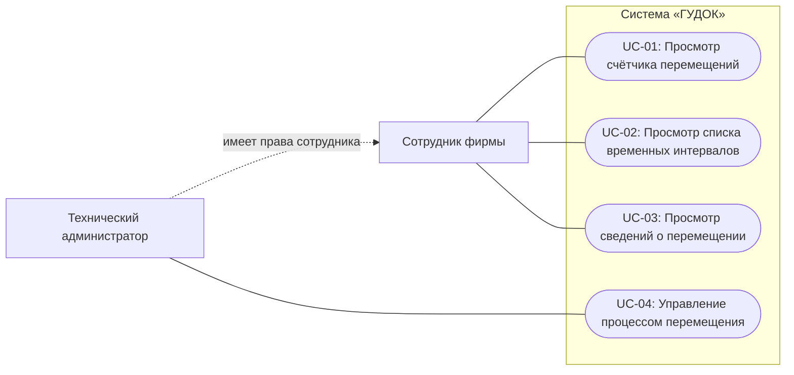
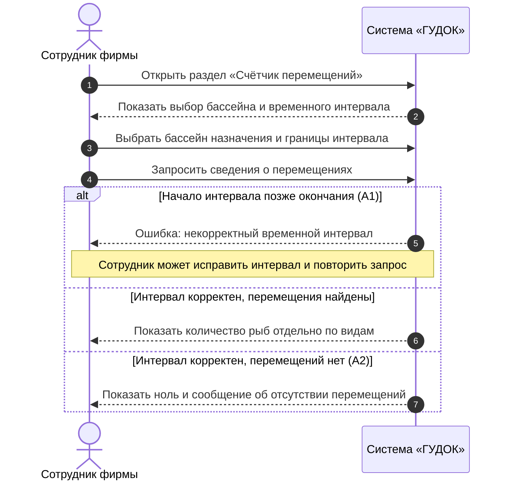
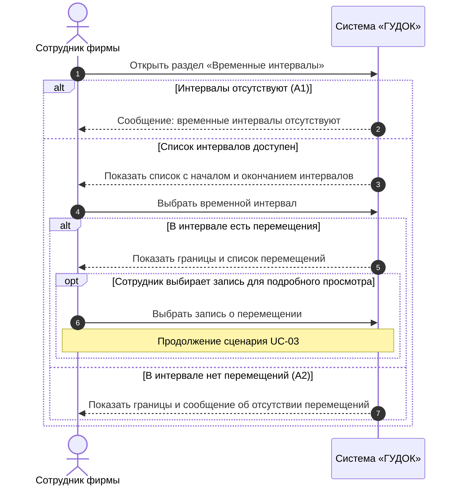
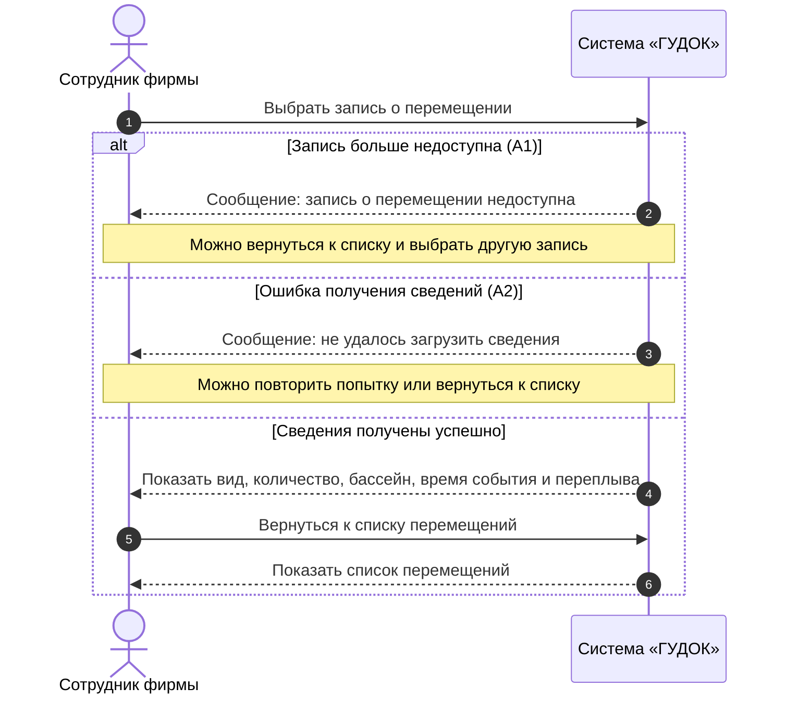
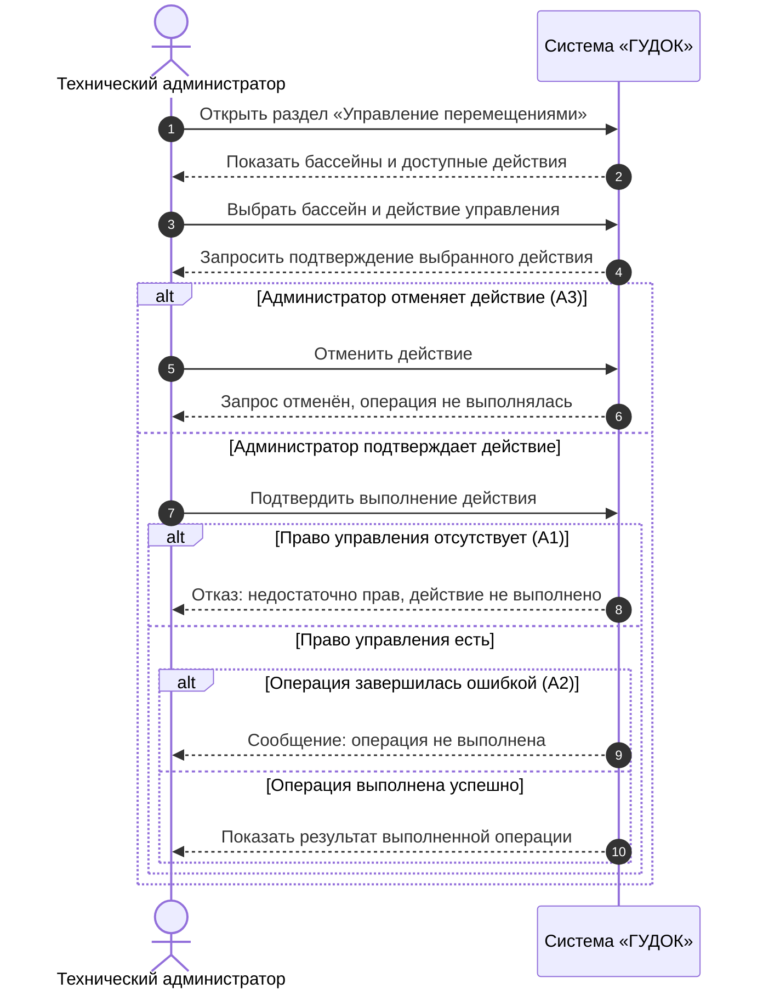

# Общий отчёт ООО «ГУДОК» по ПЗ № 1–4

**Дисциплина:** Программная инженерия  
**Программный продукт:** система учёта перемещений рыб между бассейнами  
**Команда:** Шейкин Д. М., Амелякин М. И., Гогичашвили Г. Л., Качурский Е. А.  
**Согласующее лицо:** Невзоров А. С.  
**Состояние:** документация подготовлена; фактические командные Git-проверки ещё не подтверждены.  
**Сверка Word:** перед сдачей необходимо проверить соответствие индивидуальных DOCX их Markdown-версиям. Общий Word-отчёт `docs/report.docx` ещё необходимо подготовить.

## Оглавление

- [Проект и материалы](#проект-и-материалы)
- [ПЗ № 1 — Интервью](#пз-1--интервью)
- [ПЗ № 2 — Варианты использования](#пз-2--варианты-использования)
- [ПЗ № 3 — UML-диаграммы](#пз-3--uml-диаграммы)
- [ПЗ № 4 — Организация Git-репозитория](#пз-4--организация-git-репозитория)

## Проект и материалы

**Назначение:** сбор и просмотр сведений о перемещениях рыб между бассейнами на рыбной ферме. Сотрудники просматривают информацию; управление процессом доступно только техническому администратору. Неопределённые детали оборудования и поступления событий являются вопросами к заказчику.

**Общий Word-отчёт:** `docs/report.docx` ещё необходимо подготовить перед сдачей.

### Индивидуальные отчёты

| Участник | Роль в проекте | Указанный ник | Сценарий | Markdown | Word |
|---|---|---|---|
| Шейкин Д. М. | Координатор проекта и технический писатель | `Koch` | UC-01 | [MD](md/sheykin-report.md) | [DOCX](doc/sheykin-report.docx) |
| Амелякин М. И. | Бизнес-аналитик и интервьюер | `selad` | UC-02 | [MD](md/amelyakin-report.md) | [DOCX](doc/amelyakin-report.docx) |
| Гогичашвили Г. Л. | Разработчик: логика учёта и модель данных | `Fwor1d` | UC-03 | [MD](md/gogichashvili-report.md) | [DOCX](doc/gogichashvili-report.docx) |
| Качурский Е. А. | Разработчик: интерфейс административного управления | `Pantera` | UC-04 | [MD](md/kachurskiy-report.md) | [DOCX](doc/kachurskiy-report.docx) |

**Примечание:** указаны ники, сообщённые командой. Для `Koch`, `selad` и `Pantera` адреса GitHub-аккаунтов и права доступа ещё не проверены. `Fwor1d` — владелец репозитория и ник Гогичашвили Г. Л. Роли являются распределением ответственности за проектирование, а не подтверждением созданного кода или самостоятельных Git-коммитов.

## ПЗ № 1 — Интервью

### Проектная инженерия — Практическая работа № 1

#### Отчёт № 1. Интервью с заказчиком

**Команда:** ООО «ГУДОК»  
**Шейкин Д.М.** — секретарь  
**Амелякин М.И.** — интервьюер  
**Гогичашвили Г.Л.** — разработчик  
**Качурский Е.А.** — разработчик

#### 1. Цель работы

Собрать первичные требования заказчика к программному продукту для рыбной фермы, определить пользователей, основные функции и ограничения, а также выделить вопросы, требующие уточнения.

#### 2. Вопросы интервью

1. Назначение программного продукта и основная задача, которую он должен решать?
2. Предполагаемые категории пользователей системы?
3. Потребности и задачи каждой категории пользователей?
4. Основные функции, которые должна выполнять система?
5. Права и ограничения различных категорий пользователей?
6. Требования к данным, которые будут храниться и обрабатываться в системе?
7. Требования к пользовательскому интерфейсу?
8. Требования к производительности системы?
9. Возможные технические и организационные ограничения?
10. Дополнительные пожелания заказчика к разрабатываемой системе?
11. По каким критериям заказчик будет оценивать готовый продукт?
12. Имеются ли примеры похожих продуктов?
13. Основные сценарии использования системы?
14. Требования к базе данных: какие данные нужно хранить, какие объекты и сведения учитывать, как долго хранить данные и кто должен иметь к ним доступ?
15. Какой бюджет вы готовы выделить на разработку?

#### 3. Зафиксированные ответы заказчика

> Ниже сохранена **исходная нумерация 12 полученных ответов**. Она не совпадает с полным списком из 15 вопросов. Ответы не перенумерованы и не представлены как ответы на другие вопросы.

1. Ферма с рыбными бассейнами. Сделать так, чтобы рыбки могли перемещаться между этими бассейнами. Должен быть счётчик, который считает, когда/сколько/какая рыба переплыла в определённый бассейн.
2. Пользование ограничено сотрудниками фирмы. Управлять процессом имеет право только технический администратор.
3. Ответ отсутствует.
4. Ответ отсутствует.
5. Ответ отсутствует.
6. Вид данных: время переплыва, тип рыбы, точное время. Система должна вести точечный отчёт о каждом передвижении.
7. Интерфейс — для простого пользования, не требующего изучения. Чётко видные временные интервалы, а также реализация списка всех интервалов с возможностью просмотра.
8. Кроссплатформенности не требуется.
9. Ответ отсутствует.
10. Программа должна работать исправно.
11. Бюджет — 1 000 000 руб.
12. Срок — 60 дней; тестовый продукт предоставлять по усмотрению и готовности.

#### 4. Первичный анализ требований

| Направление | Установлено по интервью | Что остаётся неизвестным |
|---|---|---|
| Назначение | Учёт перемещений рыб между бассейнами | Конкретный способ перемещения и наблюдения |
| Пользователи | Сотрудники фирмы | Перечень должностей и индивидуальные права просмотра |
| Управление | Только технический администратор | Конкретные команды и взаимодействие с оборудованием |
| Функции | Счётчик, сведения о каждом переплыве, просмотр интервалов | Фильтры, экспорт, уведомления, корректировка записей |
| Данные | Тип рыбы, время/длительность переплыва, точное время события | Идентификаторы рыб, бассейны, точность времени, источник данных |
| Интерфейс | Простой, наглядные интервалы, список для просмотра | Экраны, язык интерфейса, устройство пользователя |
| Платформа | Кроссплатформенность не обязательна | Операционная система и способ развёртывания |
| Производительность | Не задана количественно | Объём событий и допустимые задержки |
| Надёжность | Общее пожелание исправной работы | Метрики доступности и порядок восстановления |
| База данных | Должны сохраняться сведения о перемещениях | Срок хранения, резервное копирование, разграничение доступа |
| Бюджет | 1 000 000 руб. | Распределение расходов и включение оборудования |
| Срок | 60 дней | Контрольные этапы и критерии приёмки |

#### 5. Вопросы для уточнения с заказчиком

1. Как распознаётся перемещение рыбы и определяется её вид: автоматически датчиками или сотрудником вручную?
2. Сколько бассейнов используется и между какими из них возможны перемещения?
3. Учёт ведётся для каждой особи или по количеству зарегистрированных переплывов?
4. Что означает «время переплыва»: момент регистрации, время начала/завершения или длительность?
5. Какие команды технический администратор должен иметь возможность отдавать?
6. Как долго хранятся данные, кто может смотреть историю и требуется ли её экспорт?
7. На какой операционной системе должна работать программа и с каким оборудованием интегрироваться?
8. По каким измеримым критериям заказчик примет результат по окончании 60 дней?

#### 6. Вывод

Из интервью определены назначение системы, основные пользователи, необходимость учёта перемещений, общие требования к интерфейсу, бюджет и срок. Часть вопросов осталась без прямых ответов; проектные уточнения из последующих практических работ нельзя считать уже согласованными с заказчиком.

---

## ПЗ № 2 — Варианты использования

### Практическое задание № 2
#### Варианты использования

**Дисциплина:** Программная инженерия  
**Команда:** ООО «ГУДОК»  
**Программный продукт:** система учёта перемещений рыб между бассейнами  
**Согласовано с:** Невзоров А. С.

##### Цель работы

Описать основные варианты использования системы на основании интервью с заказчиком: определить действующих лиц, предусловия, основной и альтернативные потоки, постусловия и связь сценариев с функциональными требованиями.

##### Исходные функциональные требования

| Идентификатор | Функциональное требование | Основание в интервью |
|---|---|---|
| ФТ-01 | Система должна учитывать сведения о перемещении рыб: вид, количество, время переплыва и точное время события. | Ответы 1, 6 |
| ФТ-02 | Система должна показывать, сколько рыб каждого вида переместилось в определённый бассейн за интересующий период. | Ответ 1 |
| ФТ-03 | Система должна показывать временные интервалы и предоставлять список интервалов для просмотра. | Ответ 7 |
| ФТ-04 | Система должна предоставлять подробные сведения о каждом перемещении рыбы. | Ответ 6 |
| ФТ-05 | Управление процессом перемещения должно быть доступно только техническому администратору. | Ответ 2 |

##### Распределение вариантов использования

| Вариант использования | Название | Разработчик | Требования |
|---|---|---|---|
| UC-01 | Просмотр счётчика перемещений | Шейкин Д. М. | ФТ-01, ФТ-02 |
| UC-02 | Просмотр списка временных интервалов | Амелякин М. И. | ФТ-03 |
| UC-03 | Просмотр сведений о перемещении | Гогичашвили Г. Л. | ФТ-01, ФТ-04 |
| UC-04 | Управление процессом перемещения | Качурский Е. А. | ФТ-05 |

---

#### Вариант использования UC-01 «Просмотр счётчика перемещений»

##### Описание

Данный вариант использования описывает получение сотрудником сведений о количестве рыб, переместившихся в выбранный бассейн за определённый временной интервал. При успешном выполнении система отображает количество рыб с разбивкой по видам.

**Разработчик:** Шейкин Д. М.  
**Согласовано с:** Невзоров А. С.

##### Действующие лица

- Сотрудник фирмы.

##### Предусловия

1. Сотрудник имеет доступ к программе.
2. В системе доступен перечень бассейнов, для которых ведётся учёт перемещений.

##### Основной поток

3. Сотрудник открывает раздел «Счётчик перемещений».
4. Система отображает выбор бассейна и временного интервала.
5. Сотрудник выбирает бассейн назначения и задаёт границы интервала.
6. Сотрудник запрашивает сведения о перемещениях.
7. Система проверяет, что начало интервала не позднее его окончания.
8. Система отображает количество рыб, переместившихся в выбранный бассейн за указанный период, отдельно для каждого вида.
9. Сотрудник просматривает результат.

##### Альтернативные потоки

**А1. Некорректный временной интервал**

10. На шаге 7 система обнаруживает, что начало интервала позднее окончания.
11. Система сообщает: «Начало интервала не может быть позднее окончания» и не показывает неверный результат.
12. Сотрудник исправляет интервал и возвращается к шагу 6.

**А2. Нет перемещений за выбранное время**

13. На шаге 8 система не находит записей, соответствующих бассейну и интервалу.
14. Система отображает нулевое количество и сообщение: «За выбранный период перемещения не зарегистрированы».
15. Сотрудник может выбрать другой интервал или завершить просмотр.

##### Постусловия

16. Сотруднику показано количество зарегистрированных рыб по выбранному бассейну и видам за указанный период (или отсутствие перемещений).
17. Учётные записи о перемещениях не изменены.

---

#### Вариант использования UC-02 «Просмотр списка временных интервалов»

##### Описание

Данный вариант использования описывает просмотр сотрудником списка временных интервалов, доступных в системе. Сотрудник выбирает интересующий интервал и получает перечень зарегистрированных в нём перемещений.

**Разработчик:** Амелякин М. И.  
**Согласовано с:** Невзоров А. С.

##### Действующие лица

- Сотрудник фирмы.

##### Предусловия

1. Сотрудник имеет доступ к программе.
2. Система доступна для просмотра информации о перемещениях.

##### Основной поток

3. Сотрудник открывает раздел «Временные интервалы».
4. Система отображает список интервалов с началом и окончанием каждого интервала.
5. Сотрудник выбирает интервал из списка.
6. Система отображает границы выбранного интервала и список перемещений рыб, относящихся к нему.
7. Сотрудник просматривает список перемещений.
8. При необходимости сотрудник выбирает запись, чтобы перейти к UC-03 «Просмотр сведений о перемещении».

##### Альтернативные потоки

**А1. В списке нет доступных интервалов**

9. На шаге 4 система не находит интервалов для отображения.
10. Система показывает сообщение: «Временные интервалы отсутствуют».
11. Сотрудник завершает просмотр.

**А2. Выбранный интервал не содержит перемещений**

12. На шаге 6 система не находит перемещений в выбранном интервале.
13. Система отображает границы интервала и сообщение: «Перемещения за выбранный интервал отсутствуют».
14. Сотрудник возвращается к списку интервалов или завершает просмотр.

##### Постусловия

15. Сотрудник получил сведения о выбранном интервале и относящихся к нему перемещениях либо сообщение об их отсутствии.
16. Данные системы не изменены.

---

#### Вариант использования UC-03 «Просмотр сведений о перемещении»

##### Описание

Данный вариант использования описывает просмотр подробной записи о конкретном перемещении рыбы или группы рыб между бассейнами. Система показывает сохранённые сведения о перемещении: вид рыбы, количество, время переплыва, точное время события и бассейн назначения.

**Разработчик:** Гогичашвили Г. Л.  
**Согласовано с:** Невзоров А. С.

##### Действующие лица

- Сотрудник фирмы.

##### Предусловия

1. Сотрудник имеет доступ к программе.
2. В системе имеется хотя бы одна запись о перемещении рыб.
3. Сотрудник находится в списке перемещений, например открытом через UC-02.

##### Основной поток

4. Сотрудник выбирает запись о перемещении.
5. Система открывает подробные сведения выбранной записи.
6. Система отображает вид рыбы, количество рыб, бассейн назначения, точное время события и сохранённое время переплыва.
7. Сотрудник изучает сведения о перемещении.
8. Сотрудник возвращается к списку перемещений.

##### Альтернативные потоки

**А1. Выбранная запись больше недоступна**

9. На шаге 5 система не может получить выбранную запись.
10. Система сообщает: «Запись о перемещении недоступна».
11. Сотрудник возвращается к списку и может выбрать другую запись.

**А2. Не удалось получить подробные сведения**

12. На шаге 5 возникает ошибка получения данных.
13. Система сообщает: «Не удалось загрузить сведения о перемещении».
14. Сотрудник повторяет попытку или возвращается к списку.

##### Постусловия

15. Сотруднику показаны подробные сведения о выбранном перемещении, если запись доступна.
16. Исходная запись о перемещении не изменена.

---

#### Вариант использования UC-04 «Управление процессом перемещения»

##### Описание

Данный вариант использования описывает выполнение техническим администратором операции управления процессом перемещения рыб между бассейнами. При успешном выполнении система принимает разрешённое администратору действие и отображает его результат.

**Разработчик:** Качурский Е. А.  
**Согласовано с:** Невзоров А. С.

##### Действующие лица

- Технический администратор.

##### Предусловия

1. Пользователь имеет право управления процессом как технический администратор.
2. Система предоставляет доступ к предусмотренной функции управления.

##### Основной поток

3. Технический администратор открывает раздел «Управление перемещениями».
4. Система отображает доступные для управления бассейны и действия.
5. Администратор выбирает бассейн и нужное действие управления.
6. Система показывает выбранное действие и запрашивает подтверждение.
7. Администратор подтверждает выполнение действия.
8. Система проверяет наличие у пользователя права управления.
9. Система выполняет предусмотренную операцию управления и отображает её результат.
10. Администратор просматривает результат операции.

##### Альтернативные потоки

**А1. Недостаточно прав для управления**

11. На шаге 8 система определяет, что у пользователя отсутствует право управления процессом.
12. Система не выполняет выбранную операцию и сообщает: «Недостаточно прав для выполнения действия».
13. Пользователь завершает сценарий.

**А2. Операция управления не выполнена**

14. На шаге 9 система получает отказ или ошибку выполнения операции.
15. Система сообщает: «Операция не выполнена» и не показывает сообщение об успешном результате.
16. Администратор может повторить операцию либо завершить сценарий.

**А3. Администратор отменил действие**

17. На шаге 6 администратор отказывается от подтверждения.
18. Система отменяет запрос на выполнение операции.
19. Администратор возвращается к выбору действий.

##### Постусловия

20. При успешном завершении выполнена выбранная разрешённая операция управления, и её результат показан администратору.
21. При отказе, ошибке или отмене успешное выполнение операции не подтверждается.

> **Требуется уточнение у заказчика:** в интервью подтверждено только то, что управлять процессом может технический администратор. Конкретные команды, способы перемещения рыб и взаимодействие с оборудованием не определены. Поэтому UC-04 описан на уровне взаимодействия пользователя с системой; содержание доступных действий и условия их выполнения необходимо согласовать до реализации.

---

#### Проверка соответствия требованиям

| Вариант использования | Функциональные требования |
|---|---|
| UC-01 «Просмотр счётчика перемещений» | ФТ-01, ФТ-02 |
| UC-02 «Просмотр списка временных интервалов» | ФТ-03 |
| UC-03 «Просмотр сведений о перемещении» | ФТ-01, ФТ-04 |
| UC-04 «Управление процессом перемещения» | ФТ-05 |

Все четыре участника описали минимум один самостоятельный вариант использования. Для каждого определены действующие лица, предусловия, основной поток, альтернативные потоки и постусловия.

**Вопрос для дальнейшего согласования:** заказчик не определил, как именно в систему поступают сведения о перемещениях (датчики, видеонаблюдение или ручной ввод). Поэтому отдельный вариант использования «Регистрация перемещения» пока не вводится: его актор и последовательность действий невозможно достоверно описать по интервью.

##### Вывод

На основании интервью определены и описаны четыре варианта использования системы «ГУДОК». Сценарии связаны с функциональными требованиями и распределены между участниками команды. Описания могут быть использованы при построении UML-диаграмм; детали управления и регистрации перемещений требуют уточнения у заказчика.

---

## ПЗ № 3 — UML-диаграммы

### Практическое задание № 3
#### Построение и оформление UML-диаграмм вариантов использования и последовательностей

**Дисциплина:** Программная инженерия  
**Команда:** ООО «ГУДОК»  
**Программный продукт:** система учёта перемещений рыб между бассейнами  
**Согласующее лицо:** Невзоров А. С.  
**Основа работы:** утверждённая ПЗ № 2 «Варианты использования»  
**Формат диаграмм:** Mermaid внутри Markdown (совместимо с отображением на GitHub)

##### Цель работы

Построить общую UML-диаграмму вариантов использования и индивидуальные диаграммы последовательностей для четырёх сценариев, описанных в ПЗ № 2. Проверить соответствие диаграмм требованиям и основным и альтернативным потокам сценариев.

##### Границы системы и действующие лица

Граница системы «ГУДОК» охватывает просмотр счётчика перемещений, временных интервалов и сведений об отдельном перемещении, а также доступное техническому администратору управление процессом перемещения. Физические бассейны, оборудование и способ регистрации событий в предмет этой диаграммы не включены, поскольку в интервью заказчик не определил, каким способом поступают данные.

**Действующие лица:**

- **Сотрудник фирмы** — просматривает сведения о перемещениях рыб.
- **Технический администратор** — сотрудник фирмы с дополнительным правом управления процессом перемещения.

Внутренняя база данных не является внешним действующим лицом. На диаграммах последовательностей система рассматривается как единый участник без детализации её внутренних компонентов.

##### 1. Общая диаграмма вариантов использования

**Формат:** Mermaid (`flowchart`) с визуальным обозначением границы системы и овальными блоками UC. Это эквивалентная по смыслу схема для просмотра в Markdown; обозначение акторов и обобщения роли не полностью повторяет графическую нотацию UML.

*Рисунок 1 — Общая диаграмма вариантов использования системы «ГУДОК».*  

| Обозначение | Название варианта использования | Действующее лицо | Функциональные требования |
|---|---|---|---|
| UC-01 | Просмотр счётчика перемещений | Сотрудник фирмы | ФТ-01, ФТ-02 |
| UC-02 | Просмотр списка временных интервалов | Сотрудник фирмы | ФТ-03 |
| UC-03 | Просмотр сведений о перемещении | Сотрудник фирмы | ФТ-01, ФТ-04 |
| UC-04 | Управление процессом перемещения | Технический администратор | ФТ-05 |

**Обоснование связей.** Сплошные линии без стрелок показывают участие действующих лиц в сценариях. Обобщение от технического администратора к сотруднику фирмы означает, что администратор обладает также правами просмотра. Связи `include` и `extend` не добавлены: в ПЗ № 2 нет основания считать один из четырёх вариантов использования обязательной частью другого либо его самостоятельным расширением. Возможность перейти из UC-02 к UC-03 описана как необязательное продолжение сценария, а не как обязательное включение. Стрелок порядка действий на диаграмме нет.

##### 2. Диаграммы последовательностей

Все четыре диаграммы последовательностей представлены в синтаксисе Mermaid на системном уровне: пользователь отправляет запрос системе «ГУДОК» и получает ответ. Ветви `alt` отражают взаимоисключающие результаты, а `opt` — необязательный переход к другому сценарию.

###### SD-01. UC-01 «Просмотр счётчика перемещений»

**Автор:** Шейкин Д. М.  
**Требования:** ФТ-01, ФТ-02.  
**Действующее лицо:** сотрудник фирмы.  
**Предусловия:** сотрудник имеет доступ к программе; доступен перечень бассейнов, для которых ведётся учёт.  
**Охваченные потоки:** основной, А1 «Некорректный временной интервал», А2 «Нет перемещений за выбранное время».

*Рисунок 2 — Диаграмма последовательностей SD-01; автор Шейкин Д. М.*  

**Соответствие шагам ПЗ № 2:** открытие раздела (3), отображение формы (4), выбор условий (5), запрос (6), проверка интервала (7), результат (8) либо альтернативные сообщения (10–14). Условие А1: начало интервала позже окончания. Если интервал корректен, система показывает количество рыб по видам либо нулевой результат при отсутствии перемещений. После А1 сотрудник может исправить интервал и повторить запрос. **Постусловие:** данные о перемещениях не изменяются.

###### SD-02. UC-02 «Просмотр списка временных интервалов»

**Автор:** Амелякин М. И.  
**Требование:** ФТ-03.  
**Действующее лицо:** сотрудник фирмы.  
**Предусловия:** сотрудник имеет доступ к программе; система доступна для просмотра перемещений.  
**Охваченные потоки:** основной, А1 «В списке нет доступных интервалов», А2 «Выбранный интервал не содержит перемещений».

*Рисунок 3 — Диаграмма последовательностей SD-02; автор Амелякин М. И.*  

**Соответствие шагам ПЗ № 2:** открытие раздела (3), показ списка (4), выбор интервала (5), показ перемещений (6), просмотр (7), необязательный переход к UC-03 (8). Ветвь А1 завершается сообщением об отсутствии интервалов (9–11), ветвь А2 показывает пустой интервал (12–14). `opt` отражает возможность открыть конкретную запись, продолжив работу в UC-03. **Постусловие:** данные не изменяются.

###### SD-03. UC-03 «Просмотр сведений о перемещении»

**Автор:** Гогичашвили Г. Л.  
**Требования:** ФТ-01, ФТ-04.  
**Действующее лицо:** сотрудник фирмы.  
**Предусловия:** сотрудник имеет доступ к программе; имеется запись о перемещении; открыт список перемещений, например через UC-02.  
**Охваченные потоки:** основной, А1 «Выбранная запись больше недоступна», А2 «Не удалось получить подробные сведения».

*Рисунок 4 — Диаграмма последовательностей SD-03; автор Гогичашвили Г. Л.*  

**Соответствие шагам ПЗ № 2:** выбор записи (4), открытие сведений (5), отображение данных (6), просмотр (7), возвращение в список (8). При недоступности записи выполняется А1 (9–11), при ошибке получения данных — А2 (12–14). На диаграмме эти ошибки разделены как альтернативные исходы одной попытки получения сведений. **Постусловие:** исходная запись не изменяется.

###### SD-04. UC-04 «Управление процессом перемещения»

**Автор:** Качурский Е. А.  
**Требование:** ФТ-05.  
**Действующее лицо:** технический администратор.  
**Предусловия:** пользователь обладает правом управления; система предоставляет предусмотренную функцию управления.  
**Охваченные потоки:** основной, А1 «Недостаточно прав», А2 «Операция не выполнена», А3 «Администратор отменил действие».

*Рисунок 5 — Диаграмма последовательностей SD-04; автор Качурский Е. А.*  

**Соответствие шагам ПЗ № 2:** открытие раздела (3), выбор действия (4–5), подтверждение (6–7), проверка прав (8), выполнение и показ результата (9–10). При изменении прав к моменту выполнения возможен отказ А1 (11–13); при ошибке операции — А2 (14–16); при отмене — А3 (17–19). Только успешная ветвь приводит к сообщению о выполнении. **Постусловие:** результат разрешённой операции показан, если она действительно выполнена. В интервью не уточнены конкретные команды управления, поэтому диаграмма не содержит вымышленных действий оборудования.

##### 3. Таблица соответствия требований, сценариев и диаграмм

| Требование | Вариант использования | Диаграмма и потоки | Автор |
|---|---|---|---|
| ФТ-01, ФТ-02 | UC-01 Просмотр счётчика перемещений | SD-01: основной, А1, А2 | Шейкин Д. М. |
| ФТ-03 | UC-02 Просмотр списка временных интервалов | SD-02: основной, А1, А2 | Амелякин М. И. |
| ФТ-01, ФТ-04 | UC-03 Просмотр сведений о перемещении | SD-03: основной, А1, А2 | Гогичашвили Г. Л. |
| ФТ-05 | UC-04 Управление процессом перемещения | SD-04: основной, А1, А2, А3 | Качурский Е. А. |

Каждый из четырёх вариантов использования связан как минимум с одним функциональным требованием. Один вариант использования и одна диаграмма последовательностей подготовлены для каждого участника команды.

##### 4. Разбор пяти ошибок учебного примера

В методичке приведён ошибочный черновик регистрации пользователей. Эти ошибки относятся к учебному примеру, **не к системе «ГУДОК»**.

| № | Ошибка в учебном черновике | Исправление и причина |
|---|---|---|
| 1 | Актор «Администратор» внутри границы системы. | Вынести актора за прямоугольник: действующее лицо является внешней ролью. |
| 2 | Внутренняя БД изображена как внешний актор. | Убрать БД с диаграммы вариантов использования: это внутренний компонент системы. |
| 3 | От «Авторизации» к «Регистрации» проведена стрелка «потом». | Удалить стрелку: диаграмма вариантов использования не задаёт хронологию, а в примере администратор уже авторизован. |
| 4 | Сообщение «Пользователь создан» стоит до проверки дубликата. | Показывать успешное создание только после проверки отсутствия дубликата. |
| 5 | После ветви «пользователь существует» выполняется создание кабинета. | Создавать учётную запись и кабинет только в успешной ветви; ветвь дубликата завершается отказом. |

На общей схеме «ГУДОК» роли показаны вне границы системы, база данных не изображается как актор, стрелок «сначала / потом» нет. Сообщение об успешном управлении появляется только в успешной ветви SD-04.

##### 5. Проверка согласованности

**Предварительная проверка подготовленного комплекта:**

| Проверяемое условие | Результат |
|---|---|
| Названия UC-01–UC-04 совпадают с ПЗ № 2. | Проверено. |
| Для каждой диаграммы последовательностей указан автор и связанный UC. | Проверено. |
| В каждой SD есть основной и хотя бы один альтернативный поток. | Проверено. |
| Все UC связаны с ФТ-01–ФТ-05. | Проверено. |
| Условие отказа не сопровождается сообщением об успешном выполнении. | Проверено. |
| Не добавлены неуточнённые акторы оборудования или датчиков. | Проверено. |

**Взаимная проверка участниками команды (необходимо выполнить перед сдачей):**

| Автор диаграммы | Предлагаемый проверяющий | Статус |
|---|---|---|
| Шейкин Д. М. | Амелякин М. И. | Ожидает проверки |
| Амелякин М. И. | Гогичашвили Г. Л. | Ожидает проверки |
| Гогичашвили Г. Л. | Качурский Е. А. | Ожидает проверки |
| Качурский Е. А. | Шейкин Д. М. | Ожидает проверки |

Каждый проверяющий должен сопоставить сообщения и условия своей проверяемой SD с шагами ПЗ № 2, отметить замечания и внесённые исправления либо указать, что замечаний нет. Результаты взаимной проверки и факт согласования с **Невзоровым А. С.** заполняются после их фактического проведения.

##### Вывод

Для системы «ГУДОК» построена одна общая UML-диаграмма вариантов использования и четыре индивидуальные диаграммы последовательностей. Ветвления в Mermaid отражают альтернативные потоки из ПЗ № 2; выявленные при сопоставлении ограничения и границы системы отражены в пояснениях. Диаграммы встроены непосредственно в Markdown в блоках `mermaid` и отображаются на GitHub без отдельных изображений. Завершение работы требует взаимной проверки диаграмм участниками и согласования с преподавателем.

> **Примечание об оформлении.** Mermaid поддерживает диаграммы последовательностей непосредственно. Общая диаграмма вариантов использования изображена средствами `flowchart`, так как у Mermaid нет отдельного стандартного типа UML Use Case. Для сдачи, если преподаватель требует строгое UML-обозначение акторов и обобщения, необходимо подготовить диаграмму в соответствующем редакторе и согласовать формат с преподавателем.

---

## ПЗ № 4 — Организация Git-репозитория

### Практическое задание № 4
#### Организация репозитория командного программного проекта

**Команда:** ООО «ГУДОК»  
**Программный продукт:** система учёта перемещений рыб между бассейнами  
**Согласующее лицо:** Невзоров А. С.

##### Цель работы

Освоить организацию Git-репозитория, размещение результатов ПЗ № 1–3 и базовый цикл командной работы с ветками, коммитами, Pull Request и взаимной проверкой.

##### Площадка и состояние выполнения

Выбрана площадка **GitHub**: на ней поддерживаются ветки, запросы на слияние, права участников, история изменений и Markdown-просмотр. Репозиторий создан: https://github.com/Fwor1d/FishPlanet. На момент подготовки изменений публично доступен только стартовый README и первый коммит; остальные материалы подготовлены локально для публикации.

**Документация подготовлена, но фактические действия на GitHub ещё не выполнены:** не проверены доступы остальных студентов, нет подтверждённых персональных коммитов, Pull Request и ревью. После выполнения этих действий раздел должен быть обновлён реальными ссылками.

##### Структура

- `README.md` — краткое описание проекта, статус и навигация.
- `CONTRIBUTING.md` и `.gitignore` — правила внесения изменений и исключений.
- `source-material/` — исходные методички.
- `docs/README.md` — полный общий отчёт.
- `docs/md/`, `docs/doc/` — индивидуальные Markdown- и Word-отчёты.
- `docs/draw/`, `docs/img/` — редактируемые исходники Mermaid и изображения диаграмм.
- `projects/src/` и `projects/docs/` — структура под будущую реализацию без фиктивного кода.
- `modules/`, `tests/`, `teams/` — пояснения к компонентам, проверкам и обязанностям.

##### Распределение индивидуальных материалов

| Участник | Закреплённая часть | Отчёт Markdown | Отчёт Word |
|---|---|---|---|
| Шейкин Д. М. | UC-01 / SD-01 | [sheykin-report.md](md/sheykin-report.md) | [sheykin-report.docx](doc/sheykin-report.docx) |
| Амелякин М. И. | UC-02 / SD-02 | [amelyakin-report.md](md/amelyakin-report.md) | [amelyakin-report.docx](doc/amelyakin-report.docx) |
| Гогичашвили Г. Л. | UC-03 / SD-03 | [gogichashvili-report.md](md/gogichashvili-report.md) | [gogichashvili-report.docx](doc/gogichashvili-report.docx) |
| Качурский Е. А. | UC-04 / SD-04 | [kachurskiy-report.md](md/kachurskiy-report.md) | [kachurskiy-report.docx](doc/kachurskiy-report.docx) |

##### Таблица 3 — Индивидуальный вклад участников

Распределение материалов приведено по подготовленным отчётам; фактическое авторство переноса и ссылки на коммиты участники заполнят после выполнения работы.

| Участник и указанный ник | Закреплённая часть | Файлы |
|---|---|---|
| Шейкин Д. М. (`Koch`) | UC-01 и SD-01 | [Markdown](md/sheykin-report.md), [Word](doc/sheykin-report.docx) |
| Амелякин М. И. (`selad`) | UC-02 и SD-02 | [Markdown](md/amelyakin-report.md), [Word](doc/amelyakin-report.docx) |
| Гогичашвили Г. Л. (`Fwor1d`) | UC-03 и SD-03 | [Markdown](md/gogichashvili-report.md), [Word](doc/gogichashvili-report.docx) |
| Качурский Е. А. (`Pantera`) | UC-04 и SD-04 | [Markdown](md/kachurskiy-report.md), [Word](doc/kachurskiy-report.docx) |

##### Порядок выполнения Git-части

1. Создать общий репозиторий с `main` на GitHub, добавить доступы участников и преподавателя.
2. Каждый участник клонирует репозиторий в собственную рабочую папку и настраивает Git-автора.
3. Внести реальное изменение в тематической ветке; проверить `git diff`, выполнить `git add`, `git commit`, `git push`.
4. Открыть PR с описанием ФТ/UC, файлами и способом проверки.
5. Получить фактическое ревью от другого участника, внести исправления и объединить PR.
6. Обновить общую ветку, сверить MD/DOCX, проверить ссылки и изображения; зафиксировать итоговый коммит.

##### Статус по критериям сдачи

| Критерий | Статус |
|---|---|
| Структура, 7 README, CONTRIBUTING, gitignore | Подготовлено локально |
| ПЗ № 1–3, UML и исходники Mermaid | В комплекте |
| Индивидуальные Markdown и DOCX | В комплекте |
| Репозиторий на GitHub | Создан; публикация материалов и проверка доступа участников предстоят |
| Самостоятельные коммиты и взаимное ревью | Не выполнено |
| Сверка перед сдачей и согласование Невзоровым А. С. | Требует фактического проведения |

##### Вывод

Подготовлена структура проекта и согласованный пакет документации для размещения в Git. Организационная и практическая часть завершится только после реальной публикации, фиксации авторства коммитов, взаимной проверки и слияния изменений.
