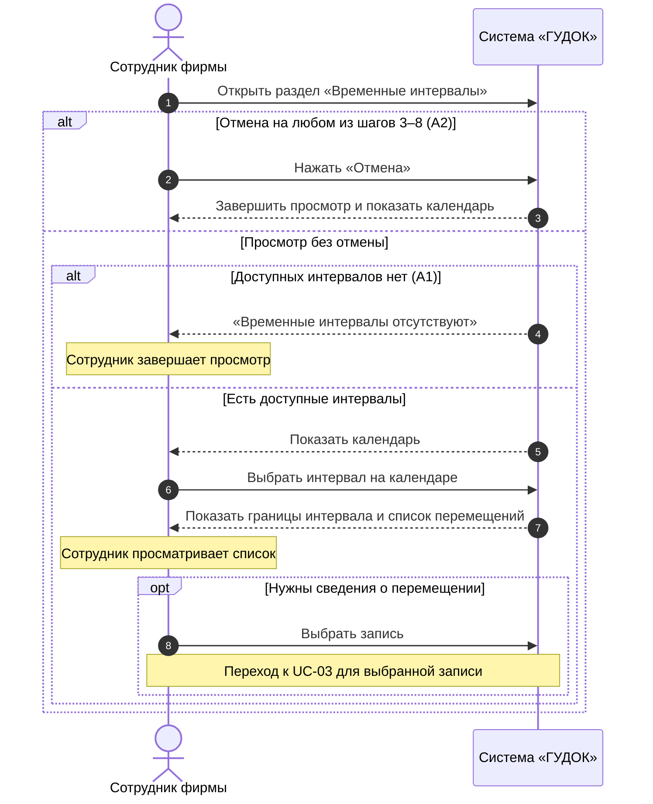

# Индивидуальный отчёт — Амелякин М. И.

**Проект:** FishPlanet — система учёта перемещений рыб между бассейнами (ООО «ГУДОК»)  
**Разработчик (закреплённый участник):** Амелякин М. И.  
**Роль в команде:** Бизнес-аналитик и интервьюер (первоначальная роль: интервьюер)  
**Учётная запись GitHub:** `se1ad`\
**Репозиторий:** https://github.com/Fwor1d/FishPlanet  
**Согласующее лицо:** Невзоров А. С.  
**Связанный сценарий:** UC-02 — Просмотр списка временных интервалов  
**Статус:** команда ознакомилась с подготовленными материалами; публикация и независимая проверка фиксируются по факту.

## 1. Задача

Моя задача — описать по требованию ФТ-03, как сотрудник выбирает временной интервал и просматривает перемещения рыб, а затем представить взаимодействие сотрудника с системой на диаграмме SD-02.

## 2. Связанные требования и варианты использования

| Идентификатор | Наименование |
|---|---|
| ФТ-03 | Система должна показывать временные интервалы и предоставлять список интервалов для просмотра. |
| UC-02 | Просмотр списка временных интервалов |

## 3. Требования к системе

Я связал UC-02 с требованием ФТ-03 из ПЗ № 2. Календарь даёт сотруднику возможность выбрать интересующий интервал.

**ФТ-03.** Система должна показывать временные интервалы и предоставлять список интервалов для просмотра.

## 4. Вариант использования (ПЗ № 2)

### Вариант использования UC-02 «Просмотр списка временных интервалов»

### Описание

Сотрудник выбирает временной интервал на календаре и просматривает перемещения рыб, зарегистрированные в его границах.

**Разработчик:** Амелякин М. И.  
**Согласовано с:** Невзоров А. С.

### Действующие лица

- Сотрудник фирмы.

### Предусловия

1. Сотрудник имеет доступ к программе.
2. Система доступна для просмотра информации о перемещениях.

### Основной поток

3. Сотрудник открывает раздел «Временные интервалы».
4. Система отображает календарь для выбора временного интервала.
5. Сотрудник выбирает интервал на календаре.
6. Система отображает границы выбранного интервала и список перемещений рыб, относящихся к нему.
7. Сотрудник просматривает список перемещений.
8. При необходимости сотрудник выбирает запись, чтобы перейти к UC-03 «Просмотр сведений о перемещении».

### Альтернативные потоки

**А1. В списке нет доступных интервалов**

9. На шаге 4 система не находит интервалов для отображения.
10. Система показывает сообщение: «Временные интервалы отсутствуют».
11. Сотрудник завершает просмотр.

**А2. Сотрудник отменяет просмотр**

12. На любом из шагов 3–8 сотрудник нажимает кнопку «Отмена».
13. Система завершает текущий просмотр.
14. Сотрудник возвращается к календарю.

### Постусловия

15. Сотрудник просмотрел перемещения за выбранный интервал, получил сообщение об отсутствии доступных интервалов или вернулся к календарю после отмены.
16. Данные системы не изменены.

## 5. Диаграмма последовательностей (ПЗ № 3)

### SD-02. UC-02 «Просмотр списка временных интервалов»

**Автор:** Амелякин М. И.\
**Требование:** ФТ-03.\
**Действующее лицо:** сотрудник фирмы.\
**Предусловия:** сотрудник имеет доступ к программе и может просматривать сведения о перемещениях.\
**Охваченные потоки:** Основной поток, А1 «Нет доступных интервалов», А2 «Сотрудник отменяет просмотр».

*Рисунок 3 — Диаграмма последовательностей SD-02 для UC-02. Автор — Амелякин М. И.*

На шагах 3–7 я показал, как сотрудник открывает раздел, выбирает интервал на календаре и просматривает перемещения в его границах. Выбор записи на шаге 8 ведёт к UC-03. Если на шаге 4 нет доступных интервалов, система выводит сообщение, и просмотр завершается (А1, шаги 9–11). Ветвью А2 я обозначил прерывание на любом из шагов 3–8. После нажатия «Отмена» система завершает текущий просмотр и возвращает сотрудника к календарю (шаги 12–14). Во всех случаях данные о перемещениях сохраняются без изменений.

## 6. Принятые проектные решения

- Я показал отсутствие доступных интервалов отдельной ветвью А1. Она начинается при открытии календаря, до выбора периода.
- В А2 я указал возврат к календарю по шагу 14 ПЗ № 2. Кнопка «Отмена» доступна и до выбора интервала, и при просмотре перемещений.
- Я оставил переход к UC-03 необязательным. Он начинается только тогда, когда сотрудник выбирает конкретную запись.

## 7. Результат

Я подготовил описание UC-02 и диаграмму SD-02 для ФТ-03. В обоих материалах выбор интервала выполняется на календаре, а отмена завершает текущий просмотр.

## 8. Проверка

Я сформулировал критерии приёмки UC-02 для проверки после реализации.

| Сценарий | Действие сотрудника и условия | Ожидаемый результат |
| --- | --- | --- |
| Основной поток, 3–7 | Открыть раздел и по очереди выбрать на календаре два интервала с разными перемещениями. | При каждом выборе видны границы выбранного интервала и только его перемещения. |
| Переход к UC-03, 8 | Выбрать одну из нескольких записей в списке. | Открываются сведения именно о выбранном перемещении. |
| А1, 9–11 | Открыть раздел, когда доступных интервалов нет. | Система показывает «Временные интервалы отсутствуют». Сотрудник завершает просмотр. |
| А2, 12–14 | В отдельных попытках нажать «Отмена» на каждом из шагов 3–8 до перехода в UC-03. | Текущий просмотр прекращается. Снова виден календарь, переход к UC-03 не выполняется. |

Для каждого исхода я предусмотрел проверку сохранности записей о перемещениях.

## 9. Вклад в работу команды

В ПЗ № 2 я уточнил выбор интервала на календаре и действия при отмене просмотра. В ПЗ № 3 я перенёс эти изменения в SD-02 и связал сообщения на диаграмме с шагами UC-02.

## 10. Связанные материалы

- [ПЗ № 2 — варианты использования](pz2-use-cases.md)
- [ПЗ № 3 — UML-диаграммы Mermaid](pz3-uml.md)
- [Общий отчёт](../README.md)
- [Редактируемый исходник диаграммы Mermaid](../draw/sd-02.mmd)
