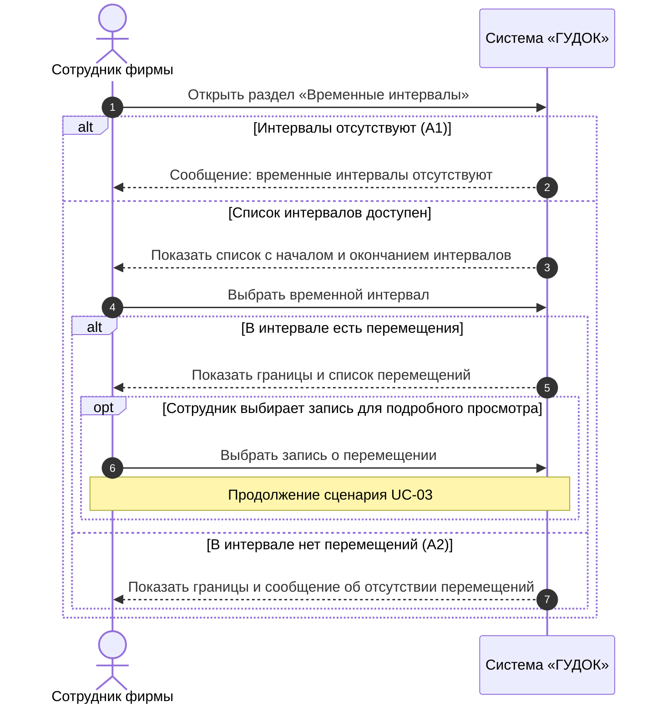

# Индивидуальный отчёт — Амелякин М. И.

**Проект:** FishPlanet — система учёта перемещений рыб между бассейнами (ООО «ГУДОК»)  
**Разработчик (закреплённый участник):** Амелякин М. И.  
**Роль в команде:** Бизнес-аналитик и интервьюер (первоначальная роль: интервьюер)  
**Учётная запись на площадке (указанный ник):** `selad`  
**Репозиторий:** https://github.com/Fwor1d/FishPlanet  
**Согласующее лицо:** Невзоров А. С.  
**Связанный сценарий:** UC-02 — Просмотр списка временных интервалов  
**Статус:** команда ознакомилась с подготовленными материалами; публикация и независимая проверка фиксируются по факту.

## 1. Задача

Описать UC-02 «Просмотр списка временных интервалов» в соответствии с требованиями заказчика и подготовить SD-02 на системном уровне. Проверить основной и альтернативные потоки и сопоставить с функциональными требованиями.

## 2. Связанные требования и варианты использования

| Идентификатор | Наименование |
|---|---|
| ФТ-03 | Система должна показывать временные интервалы и предоставлять список интервалов для просмотра. |
| UC-02 | Просмотр списка временных интервалов |

## 3. Требования к системе

Требования взяты из утверждённой ПЗ № 2 и исходного интервью. Дополнительные функции оборудования не предполагаются.

**ФТ-03.** Система должна показывать временные интервалы и предоставлять список интервалов для просмотра.

## 4. Вариант использования (ПЗ № 2)

### Вариант использования UC-02 «Просмотр списка временных интервалов»

### Описание

Данный вариант использования описывает просмотр сотрудником списка временных интервалов, доступных в системе. Сотрудник выбирает интересующий интервал и получает перечень зарегистрированных в нём перемещений.

**Разработчик:** Амелякин М. И.  
**Согласовано с:** Невзоров А. С.

### Действующие лица

- Сотрудник фирмы.

### Предусловия

1. Сотрудник имеет доступ к программе.
2. Система доступна для просмотра информации о перемещениях.

### Основной поток

3. Сотрудник открывает раздел «Временные интервалы».
4. Система отображает список интервалов с началом и окончанием каждого интервала.
5. Сотрудник выбирает интервал из списка.
6. Система отображает границы выбранного интервала и список перемещений рыб, относящихся к нему.
7. Сотрудник просматривает список перемещений.
8. При необходимости сотрудник выбирает запись, чтобы перейти к UC-03 «Просмотр сведений о перемещении».

### Альтернативные потоки

**А1. В списке нет доступных интервалов**

9. На шаге 4 система не находит интервалов для отображения.
10. Система показывает сообщение: «Временные интервалы отсутствуют».
11. Сотрудник завершает просмотр.

**А2. Выбранный интервал не содержит перемещений**

12. На шаге 6 система не находит перемещений в выбранном интервале.
13. Система отображает границы интервала и сообщение: «Перемещения за выбранный интервал отсутствуют».
14. Сотрудник возвращается к списку интервалов или завершает просмотр.

### Постусловия

15. Сотрудник получил сведения о выбранном интервале и относящихся к нему перемещениях либо сообщение об их отсутствии.
16. Данные системы не изменены.

## 5. Диаграмма последовательностей (ПЗ № 3)

### SD-02. UC-02 «Просмотр списка временных интервалов»

**Автор:** Амелякин М. И.  
**Требование:** ФТ-03.  
**Действующее лицо:** сотрудник фирмы.  
**Предусловия:** сотрудник имеет доступ к программе; система доступна для просмотра перемещений.  
**Охваченные потоки:** основной, А1 «В списке нет доступных интервалов», А2 «Выбранный интервал не содержит перемещений».

*Рисунок 3 — Диаграмма последовательностей SD-02; автор Амелякин М. И.* 

**Соответствие шагам ПЗ № 2:** открытие раздела (3), показ списка (4), выбор интервала (5), показ перемещений (6), просмотр (7), необязательный переход к UC-03 (8). Ветвь А1 завершается сообщением об отсутствии интервалов (9–11), ветвь А2 показывает пустой интервал (12–14). `opt` отражает возможность открыть конкретную запись, продолжив работу в UC-03. **Постусловие:** данные не изменяются.

## 6. Принятые проектные решения

- Разграничены отсутствие интервалов в системе и отсутствие перемещений внутри выбранного интервала; открытие подробностей учтено как необязательный переход к UC-03.
- Названия действий и альтернатив сохранены из ПЗ № 2; схема последовательностей использует тот же UC-02.
- Неподтверждённые детали оборудования, автоматического распознавания рыб и хранения данных не добавлены.

## 7. Результат

- Описан UC-02 с предусловиями, основным потоком, альтернативами и постусловиями.
- Построена диаграмма SD-02 по Mermaid-коду из утверждённой ПЗ № 3.
- Связанные требования: ФТ-03.

## 8. Проверка

Сверены основной поток и альтернативы А1, А2 с UC-02 и SD-02. Независимая проверка в GitHub Pull Request ещё не подтверждена.

## 9. Вклад в работу команды

За участником закреплены UC-02 «Просмотр списка временных интервалов», его описание и согласованная с ним диаграмма SD-02. Индивидуальный раздел включён в общий комплект проекта; фактический вклад в историю Git определяется по опубликованным коммитам и Pull Request.

## 10. Связанные материалы

- [ПЗ № 2 — варианты использования](pz2-use-cases.md)
- [ПЗ № 3 — UML-диаграммы Mermaid](pz3-uml.md)
- [Общий отчёт](../README.md)
- [Редактируемая диаграмма Mermaid](pz3-uml.md#2-диаграммы-последовательностей)
- [Редактируемый исходник диаграммы Mermaid](../draw/sd-02.mmd)
