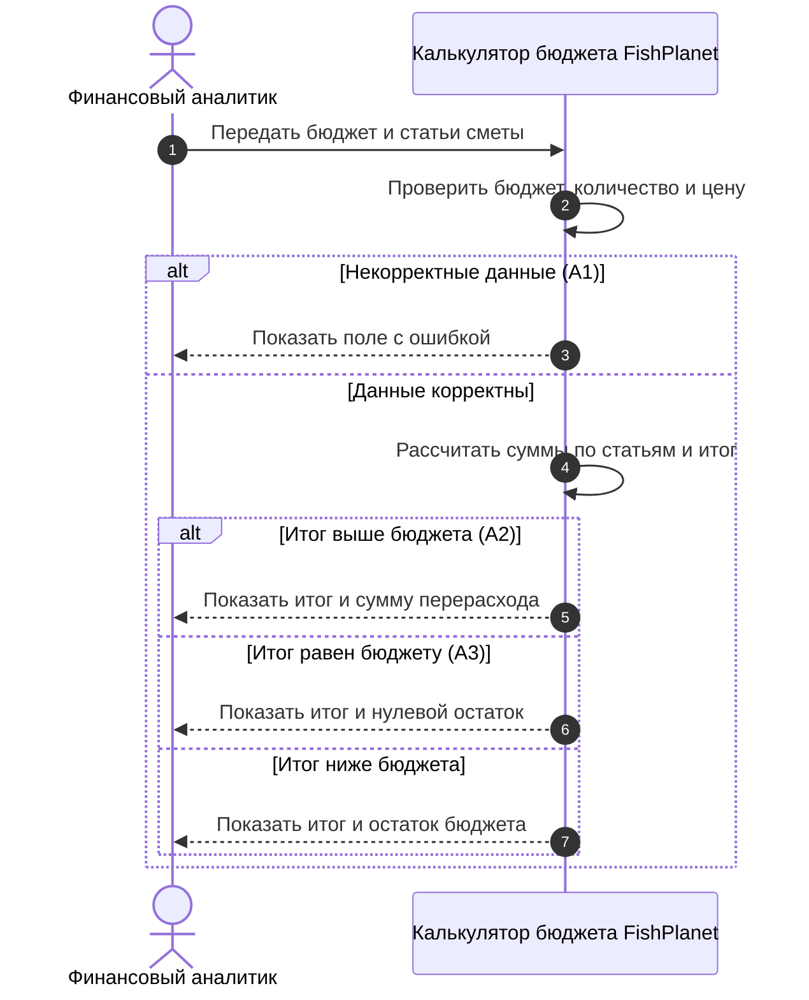

# Оценка бюджета FishPlanet

**Предложение для ПЗ № 2–5.** Пятый участник выполняет роль финансового аналитика и отвечает за смету реализации FishPlanet. По [интервью ПЗ № 1](pz1-interview.md) бюджет проекта составляет **1 000 000 ₽**. Калькулятор сметы предлагается как отдельный инструмент для команды. Для включения в индивидуальные задания требуется согласовать UC-05 и новые требования.

## ПЗ № 2 Требования и UC-05

| Требование на согласование | Формулировка |
| --- | --- |
| ФТ-06 | Система должна рассчитывать стоимость каждой статьи сметы как произведение количества на цену за единицу и возвращать общую плановую стоимость. |
| ФТ-07 | Система должна сравнивать общую стоимость с бюджетом и показывать остаток или перерасход. При некорректном вводе система должна указать поле с ошибкой. |

**UC-05 «Оценка бюджета проекта»**

- **Действующее лицо:** финансовый аналитик команды.
- **Предусловие:** финансовому аналитику известен лимит бюджета и доступны оценки затрат.
- **Результат:** аналитик видит сумму по каждой статье, общий итог и остаток или перерасход.

### Основной поток

1. Аналитик передаёт лимит бюджета и список статей. У каждой статьи есть название, количество и цена за единицу.
2. Калькулятор проверяет входные данные.
3. Калькулятор вычисляет стоимость каждой статьи и складывает суммы.
4. Калькулятор сравнивает итог с лимитом и показывает плановую стоимость и остаток бюджета.

### Альтернативные потоки

- **А1. Некорректный ввод.** Калькулятор указывает ошибочное поле. Аналитик исправляет данные и повторяет расчёт.
- **А2. Итог выше лимита.** Калькулятор показывает плановую стоимость и сумму перерасхода.
- **А3. Итог равен лимиту.** Калькулятор показывает, что бюджет использован полностью, остаток составляет 0 ₽.

## ПЗ № 3 Диаграмма последовательности SD-05



[Исходник SD-05](../draw/sd-05.mmd)

## ПЗ № 4 Роль и репозиторий

Финансовый аналитик отвечает за UC-05, SD-05 и самостоятельную реализацию калькулятора. После назначения участника его ФИО и ник добавляются в [таблицу команды](../../teams/README.md). Для индивидуальной работы предусмотрена ветка `<фамилия-латиницей>/budget-estimator` и каталог `modules/budget-estimator/`.

## ПЗ № 5 Интерфейс модуля

Планируемый модуль запускается отдельно на Python 3.12. На входе собственный файл сметы в UTF-8 JSON. На выходе суммы по статьям, общий итог и результат сравнения с бюджетом. Модуль работает со своим набором данных.

```json
{
  "budget_rub": 1000000,
  "items": [
    {"name": "Оборудование", "quantity": 2, "unit_cost_rub": 150000},
    {"name": "Разработка", "quantity": 1, "unit_cost_rub": 500000},
    {"name": "Тестирование", "quantity": 1, "unit_cost_rub": 100000}
  ]
}
```

В учебной версии суммы измеряются в целых рублях. Бюджет и количество должны быть положительными, цена может быть нулевой. У каждой статьи нужно указать название, список статей должен содержать хотя бы одну запись.

| Вариант проверки | Ожидаемый результат |
| --- | --- |
| Смета из примера | 900 000 ₽, остаток 100 000 ₽ |
| Цена тестирования 200 000 ₽ | 1 000 000 ₽, остаток 0 ₽ |
| Цена тестирования 250 000 ₽ | 1 050 000 ₽, перерасход 50 000 ₽ |
| Отрицательная цена или нулевое количество | Сообщение с указанием ошибочного поля |

Цены в примере условные. Назначенный участник оформляет в своей ветке код, демонстрационный JSON и README с командами запуска.
