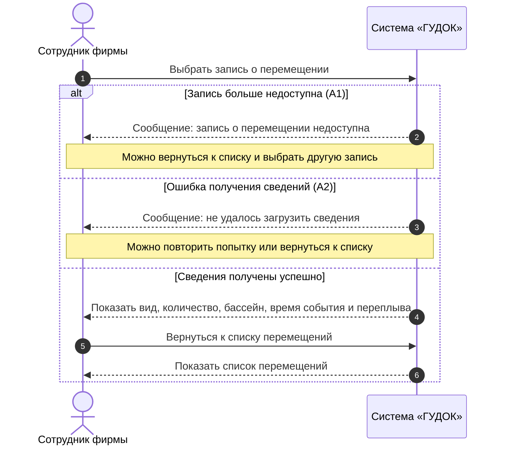

# Индивидуальный отчёт — Гогичашвили Г. Л.

**Проект:** FishPlanet — система учёта перемещений рыб между бассейнами (ООО «ГУДОК»)  
**Разработчик (закреплённый участник):** Гогичашвили Г. Л.  
**Роль в команде:** Разработчик: логика учёта и модель данных (первоначальная роль: разработчик)  
**Учётная запись на площадке (указанный ник):** `Fwor1d`  
**Репозиторий:** https://github.com/Fwor1d/FishPlanet  
**Согласующее лицо:** Невзоров А. С.  
**Связанный сценарий:** UC-03 — Просмотр сведений о перемещении  
**Статус:** команда ознакомилась с подготовленными материалами; публикация и независимая проверка фиксируются по факту.

## 1. Задача

Описать UC-03 «Просмотр сведений о перемещении» в соответствии с требованиями заказчика и подготовить SD-03 на системном уровне. Проверить основной и альтернативные потоки и сопоставить с функциональными требованиями.

## 2. Связанные требования и варианты использования

| Идентификатор | Наименование |
|---|---|
| ФТ-01 | Система должна учитывать сведения о перемещении рыб: вид, количество, время переплыва и точное время события. |
| ФТ-04 | Система должна предоставлять подробные сведения о каждом перемещении рыбы. |
| UC-03 | Просмотр сведений о перемещении |

## 3. Требования к системе

Требования взяты из утверждённой ПЗ № 2 и исходного интервью. Дополнительные функции оборудования не предполагаются.

**ФТ-01.** Система должна учитывать сведения о перемещении рыб: вид, количество, время переплыва и точное время события.

**ФТ-04.** Система должна предоставлять подробные сведения о каждом перемещении рыбы.

## 4. Вариант использования (ПЗ № 2)

### Вариант использования UC-03 «Просмотр сведений о перемещении»

### Описание

Данный вариант использования описывает просмотр подробной записи о конкретном перемещении рыбы или группы рыб между бассейнами. Система показывает сохранённые сведения о перемещении: вид рыбы, количество, время переплыва, точное время события и бассейн назначения.

**Разработчик:** Гогичашвили Г. Л.  
**Согласовано с:** Невзоров А. С.

### Действующие лица

- Сотрудник фирмы.

### Предусловия

1. Сотрудник имеет доступ к программе.
2. В системе имеется хотя бы одна запись о перемещении рыб.
3. Сотрудник находится в списке перемещений, например открытом через UC-02.

### Основной поток

4. Сотрудник выбирает запись о перемещении.
5. Система открывает подробные сведения выбранной записи.
6. Система отображает вид рыбы, количество рыб, бассейн назначения, точное время события и сохранённое время переплыва.
7. Сотрудник изучает сведения о перемещении.
8. Сотрудник возвращается к списку перемещений.

### Альтернативные потоки

**А1. Выбранная запись больше недоступна**

9. На шаге 5 система не может получить выбранную запись.
10. Система сообщает: «Запись о перемещении недоступна».
11. Сотрудник возвращается к списку и может выбрать другую запись.

**А2. Не удалось получить подробные сведения**

12. На шаге 5 возникает ошибка получения данных.
13. Система сообщает: «Не удалось загрузить сведения о перемещении».
14. Сотрудник повторяет попытку или возвращается к списку.

### Постусловия

15. Сотруднику показаны подробные сведения о выбранном перемещении, если запись доступна.
16. Исходная запись о перемещении не изменена.

## 5. Диаграмма последовательностей (ПЗ № 3)

### SD-03. UC-03 «Просмотр сведений о перемещении»

**Автор:** Гогичашвили Г. Л.  
**Требования:** ФТ-01, ФТ-04.  
**Действующее лицо:** сотрудник фирмы.  
**Предусловия:** сотрудник имеет доступ к программе; имеется запись о перемещении; открыт список перемещений, например через UC-02.  
**Охваченные потоки:** основной, А1 «Выбранная запись больше недоступна», А2 «Не удалось получить подробные сведения».
  

*Рисунок 4 — Диаграмма последовательностей SD-03; автор Гогичашвили Г. Л.*  

**Соответствие шагам ПЗ № 2:** выбор записи (4), открытие сведений (5), отображение данных (6), просмотр (7), возвращение в список (8). При недоступности записи выполняется А1 (9–11), при ошибке получения данных — А2 (12–14). На диаграмме эти ошибки разделены как альтернативные исходы одной попытки получения сведений. **Постусловие:** исходная запись не изменяется.

## 6. Принятые проектные решения

- Для одной записи предусмотрены вид и количество рыб, бассейн назначения, точный момент события и время переплыва. Недоступность записи отделена от ошибки загрузки; просмотр не изменяет данные.
- Названия действий и альтернатив сохранены из ПЗ № 2; схема последовательностей использует тот же UC-03.
- Неподтверждённые детали оборудования, автоматического распознавания рыб и хранения данных не добавлены.

## 7. Результат

- Описан UC-03 с предусловиями, основным потоком, альтернативами и постусловиями.
- Построена диаграмма SD-03 по Mermaid-коду из утверждённой ПЗ № 3.
- Связанные требования: ФТ-01, ФТ-04.

## 8. Проверка

Сверены возвращение к списку и ветви А1, А2 в UC-03 и SD-03. Независимая проверка в GitHub Pull Request ещё не подтверждена.

## 9. Вклад в работу команды

За участником закреплены UC-03 «Просмотр сведений о перемещении», его описание и согласованная с ним диаграмма SD-03. Индивидуальный раздел включён в общий комплект проекта; фактический вклад в историю Git определяется по опубликованным коммитам и Pull Request.

## 10. Связанные материалы

- [ПЗ № 2 — варианты использования](pz2-use-cases.md)
- [ПЗ № 3 — UML-диаграммы Mermaid](pz3-uml.md)
- [Общий отчёт](../README.md)
- [Редактируемая диаграмма Mermaid](pz3-uml.md#2-диаграммы-последовательностей)
- [Редактируемый исходник диаграммы Mermaid](../draw/sd-03.mmd)
