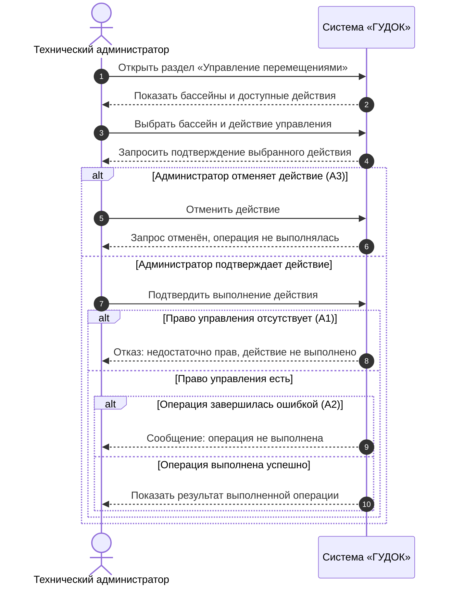

# Индивидуальный отчёт — Качурский Е. А.

**Проект:** FishPlanet — система учёта перемещений рыб между бассейнами (ООО «ГУДОК»)  
**Разработчик (закреплённый участник):** Качурский Е. А.  
**Роль в команде:** Разработчик: интерфейс административного управления (первоначальная роль: разработчик)  
**Учётная запись на площадке (указанный ник):** `Pantera`  
**Репозиторий:** https://github.com/Fwor1d/FishPlanet  
**Согласующее лицо:** Невзоров А. С.  
**Связанный сценарий:** UC-04 — Управление процессом перемещения  
**Статус:** команда ознакомилась с подготовленными материалами; публикация и независимая проверка фиксируются по факту.

## 1. Задача

Описать UC-04 «Управление процессом перемещения» в соответствии с требованиями заказчика и подготовить SD-04 на системном уровне. Проверить основной и альтернативные потоки и сопоставить с функциональными требованиями.

## 2. Связанные требования и варианты использования

| Идентификатор | Наименование |
|---|---|
| ФТ-05 | Управление процессом перемещения должно быть доступно только техническому администратору. |
| UC-04 | Управление процессом перемещения |

## 3. Требования к системе

Требования взяты из утверждённой ПЗ № 2 и исходного интервью. Дополнительные функции оборудования не предполагаются.

**ФТ-05.** Управление процессом перемещения должно быть доступно только техническому администратору.

## 4. Вариант использования (ПЗ № 2)

### Вариант использования UC-04 «Управление процессом перемещения»

### Описание

Данный вариант использования описывает выполнение техническим администратором операции управления процессом перемещения рыб между бассейнами. При успешном выполнении система принимает разрешённое администратору действие и отображает его результат.

**Разработчик:** Качурский Е. А.  
**Согласовано с:** Невзоров А. С.

### Действующие лица

- Технический администратор.

### Предусловия

1. Пользователь имеет право управления процессом как технический администратор.
2. Система предоставляет доступ к предусмотренной функции управления.

### Основной поток

3. Технический администратор открывает раздел «Управление перемещениями».
4. Система отображает доступные для управления бассейны и действия.
5. Администратор выбирает бассейн и нужное действие управления.
6. Система показывает выбранное действие и запрашивает подтверждение.
7. Администратор подтверждает выполнение действия.
8. Система проверяет наличие у пользователя права управления.
9. Система выполняет предусмотренную операцию управления и отображает её результат.
10. Администратор просматривает результат операции.

### Альтернативные потоки

**А1. Недостаточно прав для управления**

11. На шаге 8 система определяет, что у пользователя отсутствует право управления процессом.
12. Система не выполняет выбранную операцию и сообщает: «Недостаточно прав для выполнения действия».
13. Пользователь завершает сценарий.

**А2. Операция управления не выполнена**

14. На шаге 9 система получает отказ или ошибку выполнения операции.
15. Система сообщает: «Операция не выполнена» и не показывает сообщение об успешном результате.
16. Администратор может повторить операцию либо завершить сценарий.

**А3. Администратор отменил действие**

17. На шаге 6 администратор отказывается от подтверждения.
18. Система отменяет запрос на выполнение операции.
19. Администратор возвращается к выбору действий.

### Постусловия

20. При успешном завершении выполнена выбранная разрешённая операция управления, и её результат показан администратору.
21. При отказе, ошибке или отмене успешное выполнение операции не подтверждается.

> **Требуется уточнение у заказчика:** в интервью подтверждено только то, что управлять процессом может технический администратор. Конкретные команды, способы перемещения рыб и взаимодействие с оборудованием не определены. Поэтому UC-04 описан на уровне взаимодействия пользователя с системой; содержание доступных действий и условия их выполнения необходимо согласовать до реализации.

## 5. Диаграмма последовательностей (ПЗ № 3)

### SD-04. UC-04 «Управление процессом перемещения»

**Автор:** Качурский Е. А.  
**Требование:** ФТ-05.  
**Действующее лицо:** технический администратор.  
**Предусловия:** пользователь обладает правом управления; система предоставляет предусмотренную функцию управления.  
**Охваченные потоки:** основной, А1 «Недостаточно прав», А2 «Операция не выполнена», А3 «Администратор отменил действие».

*Рисунок 5 — Диаграмма последовательностей SD-04; автор Качурский Е. А.*  

> Внимание: общая диаграмма Use Case - Mermaid-представление, не строгое UML-изображение акторов. Остальные четыре диаграммы последовательностей.

**Соответствие шагам ПЗ № 2:** открытие раздела (3), выбор действия (4–5), подтверждение (6–7), проверка прав (8), выполнение и показ результата (9–10). При изменении прав к моменту выполнения возможен отказ А1 (11–13); при ошибке операции — А2 (14–16); при отмене — А3 (17–19). Только успешная ветвь приводит к сообщению о выполнении. 
**Постусловие:** результат разрешённой операции показан, если она действительно выполнена. В интервью не уточнены конкретные команды управления, поэтому диаграмма не содержит вымышленных действий оборудования.

## 6. Принятые проектные решения

- Операции управления доступны только техническому администратору. Отмена действия, отказ по правам и ошибка операции не приводят к сообщению об успешном выполнении; команды оборудования не выдумываются.
- Названия действий и альтернатив сохранены из ПЗ № 2; схема последовательностей использует тот же UC-04.
- Неподтверждённые детали оборудования, автоматического распознавания рыб и хранения данных не добавлены.

## 7. Результат

- Описан UC-04 с предусловиями, основным потоком, альтернативами и постусловиями.
- Построена диаграмма SD-04 по Mermaid-коду из утверждённой ПЗ № 3.
- Связанные требования: ФТ-05.

## 8. Проверка

Сверены основной поток и три альтернативы UC-04 и SD-04. Независимая проверка в GitHub Pull Request ещё не подтверждена.

## 9. Вклад в работу команды

За участником закреплены UC-04 «Управление процессом перемещения», его описание и согласованная с ним диаграмма SD-04. Индивидуальный раздел включён в общий комплект проекта; фактический вклад в историю Git определяется по опубликованным коммитам и Pull Request.

## 10. Связанные материалы

- [ПЗ № 2 — варианты использования](pz2-use-cases.md)
- [ПЗ № 3 — UML-диаграммы Mermaid](pz3-uml.md)
- [Общий отчёт](../README.md)
- [Редактируемая диаграмма Mermaid](pz3-uml.md#2-диаграммы-последовательностей)
- [Редактируемый исходник диаграммы Mermaid](../draw/sd-04.mmd)
