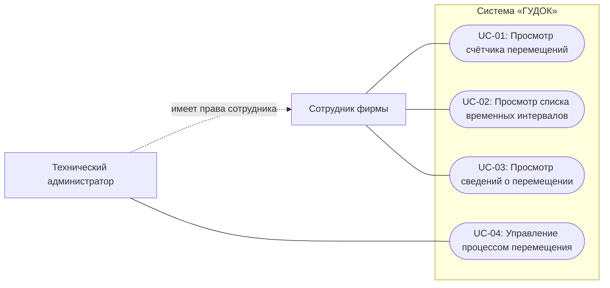
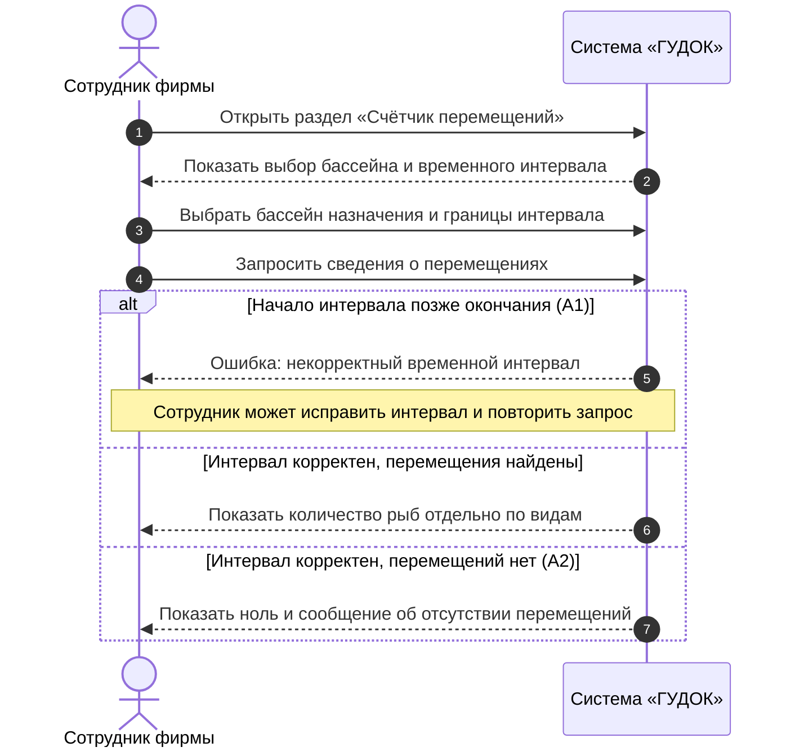
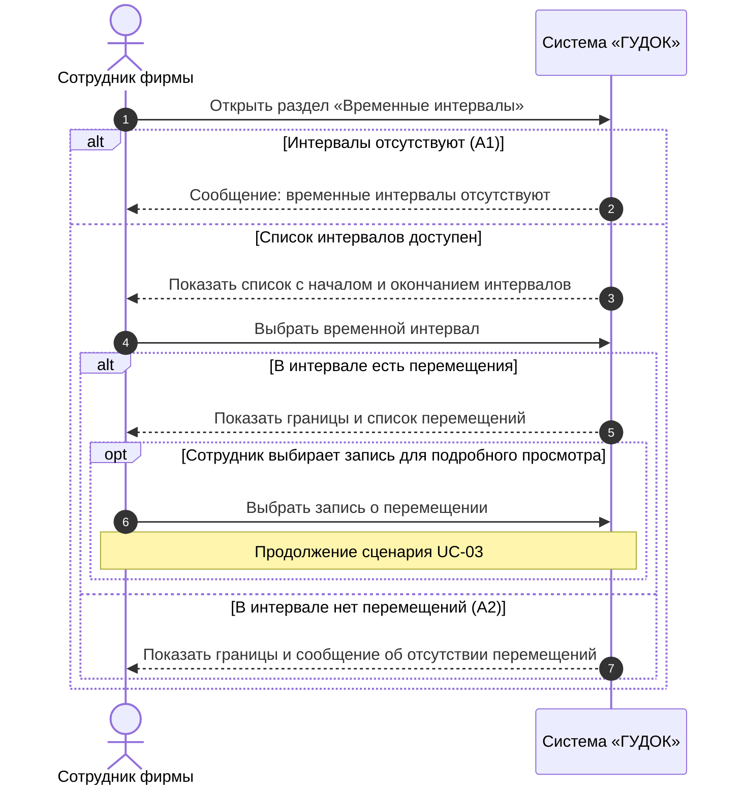
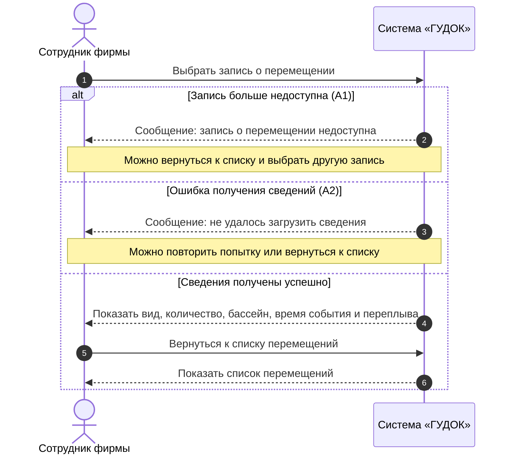
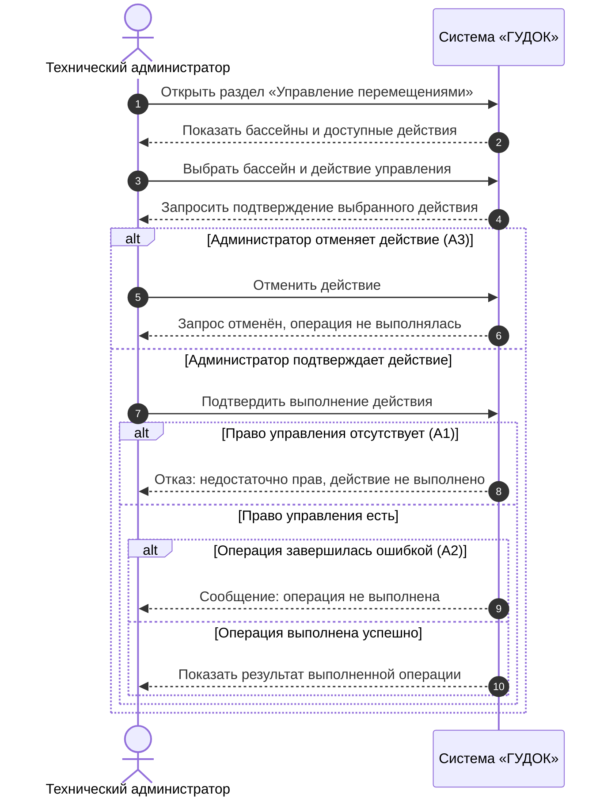

# Практическое задание № 3 Построение и оформление UML-диаграмм вариантов использования и последовательностей

**Дисциплина:** Программная инженерия  
**Команда:** ООО «ГУДОК»  
**Программный продукт:** система учёта перемещений рыб между бассейнами  
**Согласующее лицо:** Невзоров А. С.  
**Основа работы:** утверждённая ПЗ № 2 «Варианты использования»

### Цель работы

Построить общую UML-диаграмму вариантов использования и индивидуальные диаграммы последовательностей для четырёх сценариев, описанных в ПЗ № 2. Проверить соответствие диаграмм требованиям и основным и альтернативным потокам сценариев.

### Границы системы и действующие лица

Граница системы «ГУДОК» охватывает просмотр счётчика перемещений, временных интервалов и сведений об отдельном перемещении, а также доступное техническому администратору управление процессом перемещения. Физические бассейны, оборудование и способ регистрации событий в предмет этой диаграммы не включены, поскольку в интервью заказчик не определил, каким способом поступают данные.

**Действующие лица:**

- **Сотрудник фирмы** — просматривает сведения о перемещениях рыб.
- **Технический администратор** — сотрудник фирмы с дополнительным правом управления процессом перемещения.

Внутренняя база данных не является внешним действующим лицом. На диаграммах последовательностей система рассматривается как единый участник без детализации её внутренних компонентов.

### 1. Общая диаграмма вариантов использования

*Рисунок 1 — Общая диаграмма вариантов использования системы «ГУДОК».*  

| Обозначение | Название варианта использования | Действующее лицо | Функциональные требования |
|---|---|---|---|
| UC-01 | Просмотр счётчика перемещений | Сотрудник фирмы | ФТ-01, ФТ-02 |
| UC-02 | Просмотр списка временных интервалов | Сотрудник фирмы | ФТ-03 |
| UC-03 | Просмотр сведений о перемещении | Сотрудник фирмы | ФТ-01, ФТ-04 |
| UC-04 | Управление процессом перемещения | Технический администратор | ФТ-05 |

**Обоснование связей.** Сплошные линии без стрелок показывают участие действующих лиц в сценариях. Обобщение от технического администратора к сотруднику фирмы означает, что администратор обладает также правами просмотра. Связи `include` и `extend` не добавлены: в ПЗ № 2 нет основания считать один из четырёх вариантов использования обязательной частью другого либо его самостоятельным расширением. Возможность перейти из UC-02 к UC-03 описана как необязательное продолжение сценария, а не как обязательное включение. Стрелок порядка действий на диаграмме нет.

### 2. Диаграммы последовательностей

Все четыре диаграммы выполнены на системном уровне: пользователь отправляет запрос системе «ГУДОК» и получает ответ. Ветви `alt` отражают взаимоисключающие результаты, а `opt` — необязательный переход к другому сценарию.

#### SD-01. UC-01 «Просмотр счётчика перемещений»

**Автор:** Шейкин Д. М.  
**Требования:** ФТ-01, ФТ-02.  
**Действующее лицо:** сотрудник фирмы.  
**Предусловия:** сотрудник имеет доступ к программе; доступен перечень бассейнов, для которых ведётся учёт.  
**Охваченные потоки:** основной, А1 «Некорректный временной интервал», А2 «Нет перемещений за выбранное время».

*Рисунок 2 — Диаграмма последовательностей SD-01; автор Шейкин Д. М.*  

**Соответствие шагам ПЗ № 2:** открытие раздела (3), отображение формы (4), выбор условий (5), запрос (6), проверка интервала (7), результат (8) либо альтернативные сообщения (10–14). Условие А1: начало интервала позже окончания. Если интервал корректен, система показывает количество рыб по видам либо нулевой результат при отсутствии перемещений. После А1 сотрудник может исправить интервал и повторить запрос. **Постусловие:** данные о перемещениях не изменяются.

#### SD-02. UC-02 «Просмотр списка временных интервалов»

**Автор:** Амелякин М. И.  
**Требование:** ФТ-03.  
**Действующее лицо:** сотрудник фирмы.  
**Предусловия:** сотрудник имеет доступ к программе; система доступна для просмотра перемещений.  
**Охваченные потоки:** основной, А1 «В списке нет доступных интервалов», А2 «Выбранный интервал не содержит перемещений».

*Рисунок 3 — Диаграмма последовательностей SD-02; автор Амелякин М. И.* 

**Соответствие шагам ПЗ № 2:** открытие раздела (3), показ списка (4), выбор интервала (5), показ перемещений (6), просмотр (7), необязательный переход к UC-03 (8). Ветвь А1 завершается сообщением об отсутствии интервалов (9–11), ветвь А2 показывает пустой интервал (12–14). `opt` отражает возможность открыть конкретную запись, продолжив работу в UC-03. **Постусловие:** данные не изменяются.

#### SD-03. UC-03 «Просмотр сведений о перемещении»

**Автор:** Гогичашвили Г. Л.  
**Требования:** ФТ-01, ФТ-04.  
**Действующее лицо:** сотрудник фирмы.  
**Предусловия:** сотрудник имеет доступ к программе; имеется запись о перемещении; открыт список перемещений, например через UC-02.  
**Охваченные потоки:** основной, А1 «Выбранная запись больше недоступна», А2 «Не удалось получить подробные сведения».
  

*Рисунок 4 — Диаграмма последовательностей SD-03; автор Гогичашвили Г. Л.*  

**Соответствие шагам ПЗ № 2:** выбор записи (4), открытие сведений (5), отображение данных (6), просмотр (7), возвращение в список (8). При недоступности записи выполняется А1 (9–11), при ошибке получения данных — А2 (12–14). На диаграмме эти ошибки разделены как альтернативные исходы одной попытки получения сведений. **Постусловие:** исходная запись не изменяется.

#### SD-04. UC-04 «Управление процессом перемещения»

**Автор:** Качурский Е. А.  
**Требование:** ФТ-05.  
**Действующее лицо:** технический администратор.  
**Предусловия:** пользователь обладает правом управления; система предоставляет предусмотренную функцию управления.  
**Охваченные потоки:** основной, А1 «Недостаточно прав», А2 «Операция не выполнена», А3 «Администратор отменил действие».

*Рисунок 5 — Диаграмма последовательностей SD-04; автор Качурский Е. А.*  

> Внимание: общая диаграмма Use Case - Mermaid-представление, не строгое UML-изображение акторов. Остальные четыре диаграммы последовательностей.

**Соответствие шагам ПЗ № 2:** открытие раздела (3), выбор действия (4–5), подтверждение (6–7), проверка прав (8), выполнение и показ результата (9–10). При изменении прав к моменту выполнения возможен отказ А1 (11–13); при ошибке операции — А2 (14–16); при отмене — А3 (17–19). Только успешная ветвь приводит к сообщению о выполнении. 
**Постусловие:** результат разрешённой операции показан, если она действительно выполнена. В интервью не уточнены конкретные команды управления, поэтому диаграмма не содержит вымышленных действий оборудования.

### 3. Таблица соответствия требований, сценариев и диаграмм

| Требование | Вариант использования | Диаграмма и потоки | Автор |
|---|---|---|---|
| ФТ-01, ФТ-02 | UC-01 Просмотр счётчика перемещений | SD-01: основной, А1, А2 | Шейкин Д. М. |
| ФТ-03 | UC-02 Просмотр списка временных интервалов | SD-02: основной, А1, А2 | Амелякин М. И. |
| ФТ-01, ФТ-04 | UC-03 Просмотр сведений о перемещении | SD-03: основной, А1, А2 | Гогичашвили Г. Л. |
| ФТ-05 | UC-04 Управление процессом перемещения | SD-04: основной, А1, А2, А3 | Качурский Е. А. |

Каждый из четырёх вариантов использования связан как минимум с одним функциональным требованием. Один вариант использования и одна диаграмма последовательностей подготовлены для каждого участника команды.

### 4. Разбор пяти ошибок учебного примера

В методичке приведён ошибочный черновик регистрации пользователей. Эти ошибки относятся к учебному примеру, **не к системе «ГУДОК»**.

| № | Ошибка в учебном черновике | Исправление и причина |
|---|---|---|
| 1 | Актор «Администратор» внутри границы системы. | Вынести актора за прямоугольник: действующее лицо является внешней ролью. |
| 2 | Внутренняя БД изображена как внешний актор. | Убрать БД с диаграммы вариантов использования: это внутренний компонент системы. |
| 3 | От «Авторизации» к «Регистрации» проведена стрелка «потом». | Удалить стрелку: диаграмма вариантов использования не задаёт хронологию, а в примере администратор уже авторизован. |
| 4 | Сообщение «Пользователь создан» стоит до проверки дубликата. | Показывать успешное создание только после проверки отсутствия дубликата. |
| 5 | После ветви «пользователь существует» выполняется создание кабинета. | Создавать учётную запись и кабинет только в успешной ветви; ветвь дубликата завершается отказом. |

В диаграммах «ГУДОК» акторы вынесены за границу системы, база данных не изображается как актор, стрелок «сначала / потом» нет. Сообщение об успешном управлении появляется только в успешной ветви SD-04.

### 5. Проверка согласованности

**Предварительная проверка подготовленного комплекта:**

| Проверяемое условие                                                 | Результат |
| ------------------------------------------------------------------- | --------- |
| Названия UC-01–UC-04 совпадают с ПЗ № 2.                            | Проверено |
| Для каждой диаграммы указан автор и связанный UC.                   | Проверено |
| В каждой SD есть основной и хотя бы один альтернативный поток.      | Проверено |
| Все UC связаны с ФТ-01–ФТ-05.                                       | Проверено |
| Условие отказа не сопровождается сообщением об успешном выполнении. | Проверено |
| Не добавлены неуточнённые акторы оборудования или датчиков.         | Проверено |

| Автор диаграммы   | Проверяющий       | Статус |
| ----------------- | ----------------- | ------ |
| Шейкин Д. М.      | Амелякин М. И.    | +      |
| Амелякин М. И.    | Гогичашвили Г. Л. | +      |
| Гогичашвили Г. Л. | Качурский Е. А.   | +      |
| Качурский Е. А.   | Шейкин Д. М.      | +      |

### Вывод

Для системы «ГУДОК» построена одна общая UML-диаграмма вариантов использования и четыре индивидуальные диаграммы последовательностей. Ветвления отражают альтернативные потоки из ПЗ № 2; выявленные при сопоставлении ограничения и границы системы отражены в пояснениях.
