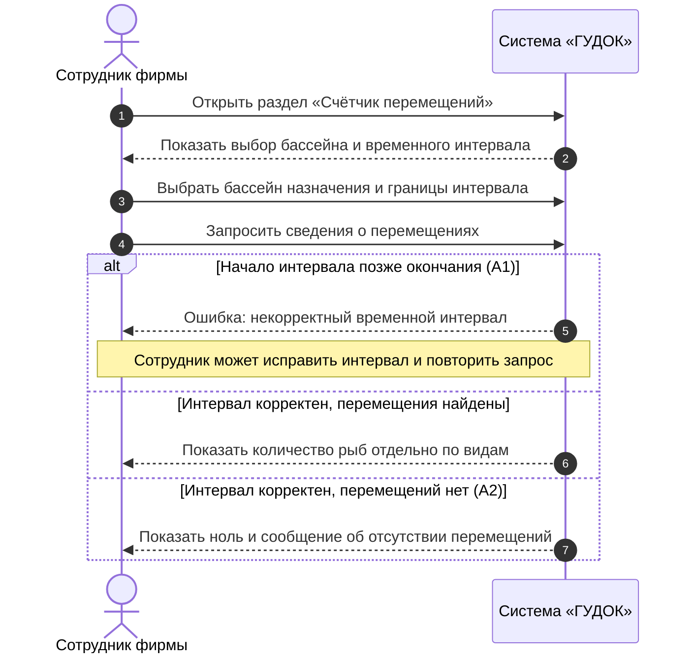

# Индивидуальный отчёт — Шейкин Д. М.

**Проект:** FishPlanet — система учёта перемещений рыб между бассейнами (ООО «ГУДОК»)  
**Разработчик (закреплённый участник):** Шейкин Д. М.  
**Роль в команде:** Координатор проекта и технический писатель (первоначальная роль: секретарь)  
**Учётная запись на площадке (указанный ник):** `Koch`  
**Репозиторий:** https://github.com/Fwor1d/FishPlanet  
**Согласующее лицо:** Невзоров А. С.  
**Связанный сценарий:** UC-01 — Просмотр счётчика перемещений  
**Статус:** команда ознакомилась с подготовленными материалами; публикация и независимая проверка фиксируются по факту.

## 1. Задача

Описать UC-01 «Просмотр счётчика перемещений» в соответствии с требованиями заказчика и подготовить SD-01 на системном уровне. Проверить основной и альтернативные потоки и сопоставить с функциональными требованиями.

## 2. Связанные требования и варианты использования

| Идентификатор | Наименование |
|---|---|
| ФТ-01 | Система должна учитывать сведения о перемещении рыб: вид, количество, время переплыва и точное время события. |
| ФТ-02 | Система должна показывать, сколько рыб каждого вида переместилось в определённый бассейн за интересующий период. |
| UC-01 | Просмотр счётчика перемещений |

## 3. Требования к системе

Требования взяты из утверждённой ПЗ № 2 и исходного интервью. Дополнительные функции оборудования не предполагаются.

**ФТ-01.** Система должна учитывать сведения о перемещении рыб: вид, количество, время переплыва и точное время события.

**ФТ-02.** Система должна показывать, сколько рыб каждого вида переместилось в определённый бассейн за интересующий период.

## 4. Вариант использования (ПЗ № 2)

### Вариант использования UC-01 «Просмотр счётчика перемещений»

### Описание

Данный вариант использования описывает получение сотрудником сведений о количестве рыб, переместившихся в выбранный бассейн за определённый временной интервал. При успешном выполнении система отображает количество рыб с разбивкой по видам.

**Разработчик:** Шейкин Д. М.  
**Согласовано с:** Невзоров А. С.

### Действующие лица

- Сотрудник фирмы.

### Предусловия

1. Сотрудник имеет доступ к программе.
2. В системе доступен перечень бассейнов, для которых ведётся учёт перемещений.

### Основной поток

3. Сотрудник открывает раздел «Счётчик перемещений».
4. Система отображает выбор бассейна и временного интервала.
5. Сотрудник выбирает бассейн назначения и задаёт границы интервала.
6. Сотрудник запрашивает сведения о перемещениях.
7. Система проверяет, что начало интервала не позднее его окончания.
8. Система отображает количество рыб, переместившихся в выбранный бассейн за указанный период, отдельно для каждого вида.
9. Сотрудник просматривает результат.

### Альтернативные потоки

**А1. Некорректный временной интервал**

10. На шаге 7 система обнаруживает, что начало интервала позднее окончания.
11. Система сообщает: «Начало интервала не может быть позднее окончания» и не показывает неверный результат.
12. Сотрудник исправляет интервал и возвращается к шагу 6.

**А2. Нет перемещений за выбранное время**

13. На шаге 8 система не находит записей, соответствующих бассейну и интервалу.
14. Система отображает нулевое количество и сообщение: «За выбранный период перемещения не зарегистрированы».
15. Сотрудник может выбрать другой интервал или завершить просмотр.

### Постусловия

16. Сотруднику показано количество зарегистрированных рыб по выбранному бассейну и видам за указанный период (или отсутствие перемещений).
17. Учётные записи о перемещениях не изменены.

## 5. Диаграмма последовательностей (ПЗ № 3)

### SD-01. UC-01 «Просмотр счётчика перемещений»

**Автор:** Шейкин Д. М.  
**Требования:** ФТ-01, ФТ-02.  
**Действующее лицо:** сотрудник фирмы.  
**Предусловия:** сотрудник имеет доступ к программе; доступен перечень бассейнов, для которых ведётся учёт.  
**Охваченные потоки:** основной, А1 «Некорректный временной интервал», А2 «Нет перемещений за выбранное время».

*Рисунок 2 — Диаграмма последовательностей SD-01; автор Шейкин Д. М.*  

**Соответствие шагам ПЗ № 2:** открытие раздела (3), отображение формы (4), выбор условий (5), запрос (6), проверка интервала (7), результат (8) либо альтернативные сообщения (10–14). Условие А1: начало интервала позже окончания. Если интервал корректен, система показывает количество рыб по видам либо нулевой результат при отсутствии перемещений. После А1 сотрудник может исправить интервал и повторить запрос. **Постусловие:** данные о перемещениях не изменяются.

## 6. Принятые проектные решения

- Определён подсчёт количества рыб с разбивкой по видам в выбранном бассейне за указанный период. Некорректные границы интервала отделены от корректного нулевого результата.
- Названия действий и альтернатив сохранены из ПЗ № 2; схема последовательностей использует тот же UC-01.
- Неподтверждённые детали оборудования, автоматического распознавания рыб и хранения данных не добавлены.

## 7. Результат

- Описан UC-01 с предусловиями, основным потоком, альтернативами и постусловиями.
- Построена диаграмма SD-01 по Mermaid-коду из утверждённой ПЗ № 3.
- Связанные требования: ФТ-01, ФТ-02.

## 8. Проверка

Сравнены запрос счётчика, проверка интервала и два альтернативных исхода с UC-01. Независимая проверка в GitHub Pull Request ещё не подтверждена.

## 9. Вклад в работу команды

За участником закреплены UC-01 «Просмотр счётчика перемещений», его описание и согласованная с ним диаграмма SD-01. Индивидуальный раздел включён в общий комплект проекта; фактический вклад в историю Git определяется по опубликованным коммитам и Pull Request.

## 10. Связанные материалы

- [ПЗ № 2 — варианты использования](pz2-use-cases.md)
- [ПЗ № 3 — UML-диаграммы Mermaid](pz3-uml.md)
- [Общий отчёт](../README.md)
- [Редактируемая диаграмма Mermaid](pz3-uml.md#2-диаграммы-последовательностей)
- [Редактируемый исходник диаграммы Mermaid](../draw/sd-01.mmd)
